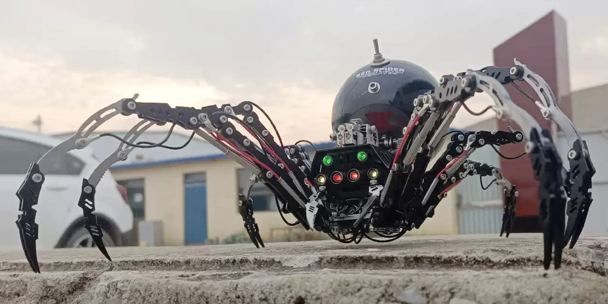

<div align="center">

# Acrylic Spider · J.A.R.V.I.S.

**HRI · Human-Robot Interaction** — ragno quadrupede a scocca acrilica su Raspberry Pi 4.

Fork di [adeept/Adeept_DarkPaw-V3](https://github.com/adeept/Adeept_DarkPaw-V3) · hardware **ADR016** · **Robot HAT V3.2**


</div>




_"A volte bisogna correre prima ancora di imparare a camminare." — Tony Stark_

---

## `//` Cos'è

Un ragno robotico a quattro zampe, **12 servi**, telecamera e strisce LED, comandabile dal browser. Il progetto parte dal codice Adeept e aggiunge: una routine dimostrativa da 25 secondi, l'esibizione automatica ogni ora, un pannello di controllo completo, le luci coordinate e una serie di correzioni per questa revisione hardware.

Tutto il movimento avviene **sul posto**: le diagonali lavorano sempre in opposizione (una zampa avanti, l'opposta indietro), così il corpo non trasla mai.

---

## `//` Hardware

| Componente | Dettaglio |
|---|---|
| Robot | Adeept DarkPaw — **ADR016**, scocca acrilica |
| Scheda | Raspberry Pi 4 Model B Rev 1.2 — 4 GB |
| Driver | **Robot HAT V3.2** — PCA9685 @ `0x40`, 12 canali servo |
| Servi | 12 × (Base, Middle, End) × 4 zampe |
| Telecamera | Pi Camera **ov5647** via CSI (libcamera / picamera2) |
| Luci | 2 strisce WS2812 su **GPIO12** (rpi_ws281x) + LED frontale su porta **P2** |
| Sensori | MPU-6050 @ `0x68` (IMU), ADS7830 @ `0x48` (tensione batteria) |

---

## `//` Software

| Livello | Stack |
|---|---|
| Sistema | Debian 13 (trixie) **aarch64**, kernel 6.18 |
| Python | 3.13 |
| Web | Flask (`:5000`) + WebSocket (`:8888`) |
| Camera | picamera2 + libcamera |
| Servi | Adafruit_PCA9685 su I2C-1 |
| Luci | rpi_ws281x (DMA/GPIO12) |
| Frontend | HTML/CSS/JS puro + [anime.js](https://animejs.com/) locale, nessun build |

---

## `//` Cosa sa fare

| Sistema | Dettaglio |
|---|---|
| 🕷️ **Locomozione** | 12 servi, passo sul posto, diagonali opposte, inclinazioni, allungo zampe |
| 🎥 **Visione** | Streaming MJPEG, inseguimento colore (OpenCV) con scelta della tinta |
| 🧭 **Sensori** | IMU MPU-6050, livellatura automatica a fine mossa |
| 🌈 **Luci** | Strisce WS2812 (respiro, polizia) + LED frontale e 3 switch |
| 🌐 **Controllo** | Pannello web da LAN e telefono, 23 mosse in loop, joystick e tastiera |
| 📊 **Telemetria** | Temperatura, carico, RAM, disco, rete — aggiornati ogni 5 s |
| 🤖 **HRI** | Routine da **25 s** all'avvio e **ogni ora**, con posa finale |

---

## `//` Pannello J.A.R.V.I.S. — `/jarvis`

Una sola pagina a schermo pieno, pensata prima per il telefono:

```
┌──────────────────────────────────────────┐
│ ◎ J.A.R.V.I.S.  ●online  ⛶  ☰           │  header compatto
├──────────────────────────────────────────┤
│                                          │
│              VIDEO (riempie)             │
│                                          │
│  ╭─────╮                      ⬆ ↥ ⬇     │  comandi in trasparenza
│  │ joy │                      ↰ ■ ↱     │  sopra il video
│  ╰─────╯                      ⚖ ↧ ✖     │
└──────────────────────────────────────────┘
```

**Guidare il ragno**

- **telefono** → joystick circolare; si attiva da solo al primo tocco
- **desktop** → tocca il video per armare i controlli, poi usa le **frecce** o WASD
- il pulsante **■** ferma subito la marcia

**La sheet dei comandi** (`☰`) ha cinque linguette, ognuna col suo colore:

| Linguetta | Contenuto |
|---|---|
| **Mosse** | 23 mosse in loop: onda larga, cascata, petalo, torsione, scalini, ventaglio, saluto, passo, posa finale… |
| **Luci** | Polizia, riposo, i tre switch, reset CV |
| **Visione** | 8 tinte pronte + selettore libero per l'inseguimento colore |
| **Info** | scheda stile neofetch: hardware, sistema, rete + barre RAM/disco/temp/swap |
| **Trim** | calibrazione dei 12 servi con contatore e reset |

**Come funziona il loop:** schiacci una mossa e si ripete; rischiacci e si ferma. Se ne premi un'altra mentre gira, cambia al volo. Il pulsante **STOP LOOP** compare solo quando serve.

---

## `//` Accesso e sicurezza

Le credenziali **non stanno nel codice**: vivono in `Server/.env` (ignorato da git) o in variabili d'ambiente.

```bash
# Server/.env
COMANDI_USER=...
COMANDI_PASS=...
```

| Aspetto | Comportamento |
|---|---|
| Login | pagina dedicata `/login` con cookie firmato **HMAC-SHA256**, durata **30 giorni** |
| Cookie | `HttpOnly` + `SameSite=Lax`, scadenza verificata lato server |
| Basic auth | **ancora accettata**, così `curl -u utente:password` funziona per script e test |
| Tentativi | 5 errori → 30 s di blocco per IP |
| API senza sessione | **401 JSON** (non un redirect HTML) |
| Logout | `/logout` cancella il cookie |
| Cambio password | basta modificare `.env` e riavviare: tutte le sessioni decadono |

> Il modello `Server/.env.example` è committabile e **non contiene password vere**.
> Se `COMANDI_USER` o `COMANDI_PASS` sono vuoti, il pannello resta **senza protezione**
> (con un avviso nei log): è una scelta per non restare chiusi fuori.

---

## `//` Routine di risveglio — 25 secondi

All'accensione e allo scatto di ogni ora:

```
1. apertura ................. dondolio laterale
2. onda larga ............... le 4 punte, ±200, sfalsate
3. altalena + scatto ........ petalo, poi passo sul posto
4. onde + colpo ............. avanti, indietro, accento secco
5. muso su / muso giù ....... impennata e inchino
6. cascata .................. le 4 zampe in sequenza, ±200
7. chiusura ................. dondolio → posa finale muso in giù
```

Durante la sequenza: **strisce in modalità polizia**, **LED frontale acceso**; alla fine frontale spento e strisce in respiro lento.

Parametri in `Server/wakeup.py`:

```python
SERVO_FRAME    = 0.020   # un aggiornamento per frame PWM (50 Hz) → niente scatti
GAIN           = 1.35    # ampiezza globale della coreografia
SWEEP_ALL_AMP  = 200     # onda larga: 300 ± 200 (fondo scala)
SWEEP_ALL_STEP = 4       # unità di PWM per frame
CASCADE_AMP    = 200     # cascata
CASCADE_STEP   = 4
FINALE_PITCH   = 0.45    # posa finale: muso in giù
FINALE_ROLL    = 0.0     # nessuna inclinazione laterale
```

> **Perché `SERVO_FRAME = 0.020` e non meno:** il PCA9685 rigenera le uscite a 50 Hz.
> Scrivendo più spesso le scritture cadono a metà frame, vengono accorpate e si vedono
> degli scatti. Un passo per frame è fluido.

---

## `//` Esibizione oraria

`Server/hourly.py` — thread interno al WebServer, protetto dallo stesso lucchetto dei comandi manuali.

```python
ENABLED = True          # False per disattivare
HOURS = set(range(24))  # es. range(8, 23) = solo 08:00–22:59
EVERY = 1               # 1 = ogni ora
```

> **Nota:** il ragno si muove da solo per 25 s ogni ora. Tienilo lontano dal bordo del
> tavolo e, se dormi nella stessa stanza, limita `HOURS`. Se un loop manuale è attivo
> da più di 2 minuti, la sequenza oraria viene saltata.

---

## `//` Struttura del repo

```
setup.py             installazione: apt, pip, servizi systemd, .env
requirements.txt     librerie Python con versioni ESATTE (bloccate con ==)
wifi-watchdog.sh     riporta il Pi sulla rete WiFi (timer ogni minuto)
Server/              web server, servi, luci, camera, routine
  wakeup.py          coreografia e primitive di movimento
  hourly.py          timer dell'esibizione oraria
  comandi.py         comandi manuali + loop, lucchetto condiviso
  sistema.py         lettura dati di sistema per la scheda Info
  app.py             Flask, API, login e sessione
  WebServer.py       avvio, WebSocket :8888, luci
  RobotLight.py      driver WS2812 (rpi_ws281x, GPIO12)
  Switch.py          LED frontale / porte P1-P2-P3 (GPIO 5/6/13)
  SpiderG.py         cinematica delle 12 zampe
  .env               credenziali (NON committare)
  .env.example       modello senza segreti
  dist/              pannello /jarvis, /login, anime.js locale
Examples/            script di test per ogni componente
Client/              app desktop opzionale
```

---

## `//` Servizio

`Adeept_Robot.service` avvia il WebServer come root (servono GPIO e I2C):

```ini
[Service]
Type=simple
User=root
WorkingDirectory=/home/pi
ExecStart=/usr/bin/python3 /home/pi/.../Server/WebServer.py
Restart=on-failure
RestartSec=5
KillMode=mixed
TimeoutStopSec=15
```

Se il processo muore, systemd lo riavvia da solo dopo 5 secondi.

```bash
sudo systemctl status Adeept_Robot
sudo systemctl restart Adeept_Robot
journalctl -u Adeept_Robot -f
```

---

## `//` Rete

Il Pi sta in rete tramite **WiFi con IP statico**, configurato via NetworkManager, così
l'indirizzo non cambia mai e i collegamenti restano validi.

Sono presenti due accorgimenti per non restare mai irraggiungibili:

| Meccanismo | Cosa fa |
|---|---|
| **WiFi watchdog** (`wifi-watchdog.timer`) | ogni minuto verifica la connessione e, se serve, la ripristina |
| **Hotspot di emergenza** | se il WiFi del modem non è disponibile, il Pi apre una rete propria con IP dedicato |

Per l'accesso da fuori casa è usato **Tailscale** (rete privata cifrata, nessuna porta
esposta su Internet). Il pannello **non è raggiungibile da Internet**: nessun port
forwarding, nessun funnel.

```bash
ssh <utente>@<ip-del-pi>          # in casa
ssh <utente>@<ip-tailscale>       # da fuori
```

> Gli indirizzi reali non sono in questo README: restano nella configurazione locale.

---

## `//` Avvio rapido

```bash
# prima installazione (apt + pip + servizi + credenziali)
sudo python3 setup.py --dry-run     # mostra cosa farebbe
sudo python3 setup.py               # installa e riavvia

# rilanciarlo è sicuro: apt salta ciò che c'è già, pip usa le versioni
# bloccate in requirements.txt e servizio/.env non vengono toccati
sudo python3 setup.py --no-reboot

# servizio (parte al boot, gestisce pannello + routine oraria)
sudo systemctl start Adeept_Robot

# pannello
http://<ip-del-pi>:5000/jarvis
```

### Provare un singolo esempio

```bash
~/run-example.sh Examples/01_LED/LED.py
~/run-example.sh Examples/04_WS2812/BreathingLight.py
~/run-example.sh Server/wakeup.py
```

Lo script ferma il servizio (libera GPIO/I2C), esegue come root con display attivo e
**riavvia il servizio** all'uscita (anche con `Ctrl+C`).

> Perché serve: un pin o il bus possono avere **un solo proprietario**. Con il servizio
> attivo un esempio dà `GPIO busy`.

---

## `//` Adattamenti per questa revisione hardware

Il codice Adeept V3 è scritto per una revisione più recente della HAT. Su questa scheda (V3.2) sono servite queste modifiche documentate:

| Componente | Adeept V3 | Questa HAT |
|---|---|---|
| PCA9685 | `0x5F` | **`0x40`** |
| Strisce WS2812 | SPI (`spidev`, GPIO10) | **rpi_ws281x su GPIO12** |
| Luci 1/2/3 | GPIO 9, 25, 11 | **GPIO 5, 6, 13** |

Senza questi adattamenti: i servi vanno in `OSError [Errno 5]` all'avvio, le strisce non si accendono e le luci risultano "disabilitate" per conflitto con lo SPI.

---

## `//` Limiti e sicurezza fisica

| Limite | Dettaglio |
|---|---|
| **Ampiezza** | i servi lavorano tra **100 e 500** di PWM; le due mosse principali stanno a 300 ± 200, cioè a fondo scala |
| **Ronzio** | un ronzio continuo e acuto significa che il servo spinge contro il fermo: ridurre `*_AMP` di 10-20 |
| **Alimentazione** | con molti servi in movimento la tensione può calare: alimentatore **5 V / 3 A o più** |
| **Coperchio/tavolo** | la routine oraria muove il ragno da sola: mai vicino al bordo |
| **Telecamera** | il flat CSI è il punto debole: se compare "CAMERA OFFLINE" per più di 15 s, controllare il contatto |

`wakeup.py` include anche un **controllo di tensione**: prima e dopo ogni mossa legge
`vcgencmd get_throttled` e segnala nei log un eventuale calo di tensione.

---

## `//` Crediti

Codice originale: **Adeept** — [adeept/Adeept_DarkPaw-V3](https://github.com/adeept/Adeept_DarkPaw-V3) (nessuna licenza esplicita: uso personale).

Interfaccia e animazioni: [anime.js](https://animejs.com/) di Julian Garnier (MIT).

Adattamenti, routine e pannello: **Henry** — [J.A.R.V.I.S. Hub](https://github.com/J-A-R-V-I-S-hub)

<div align="center">

<sub><i>"Sometimes you gotta run before you can walk."</i> — Tony Stark</sub>

</div>
